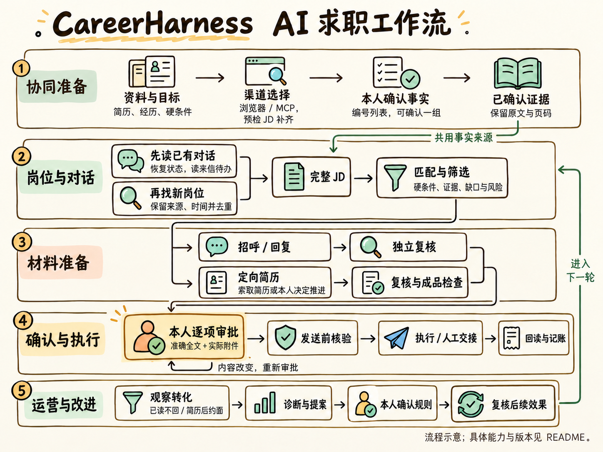
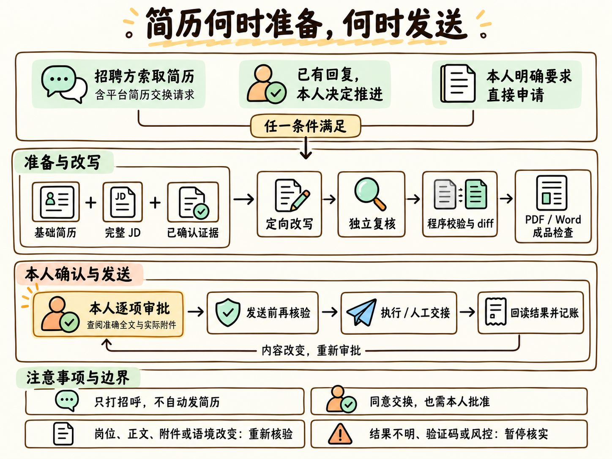
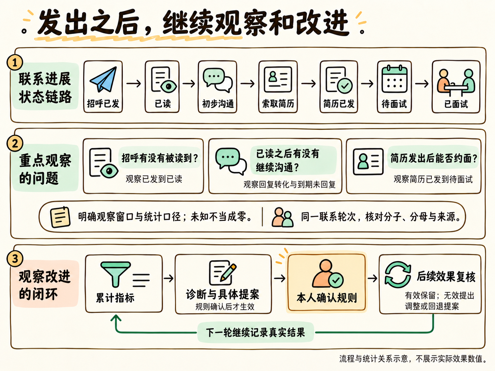
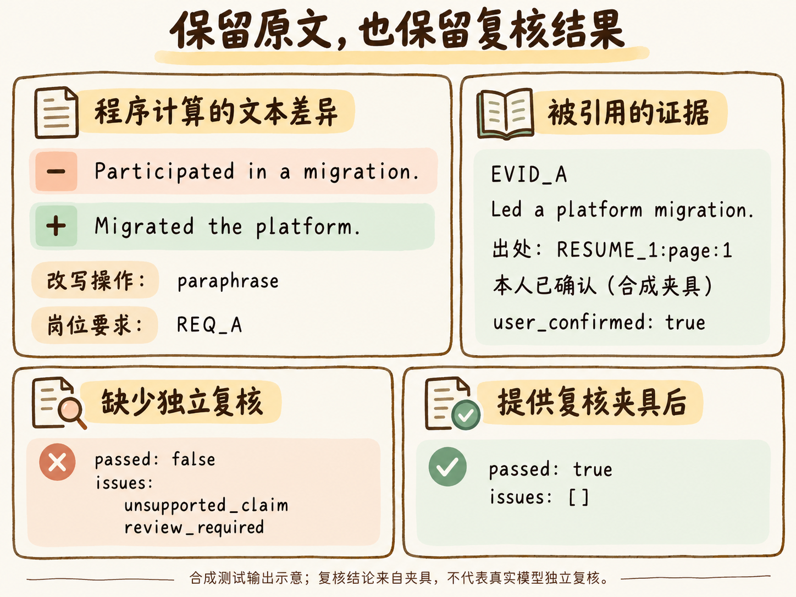
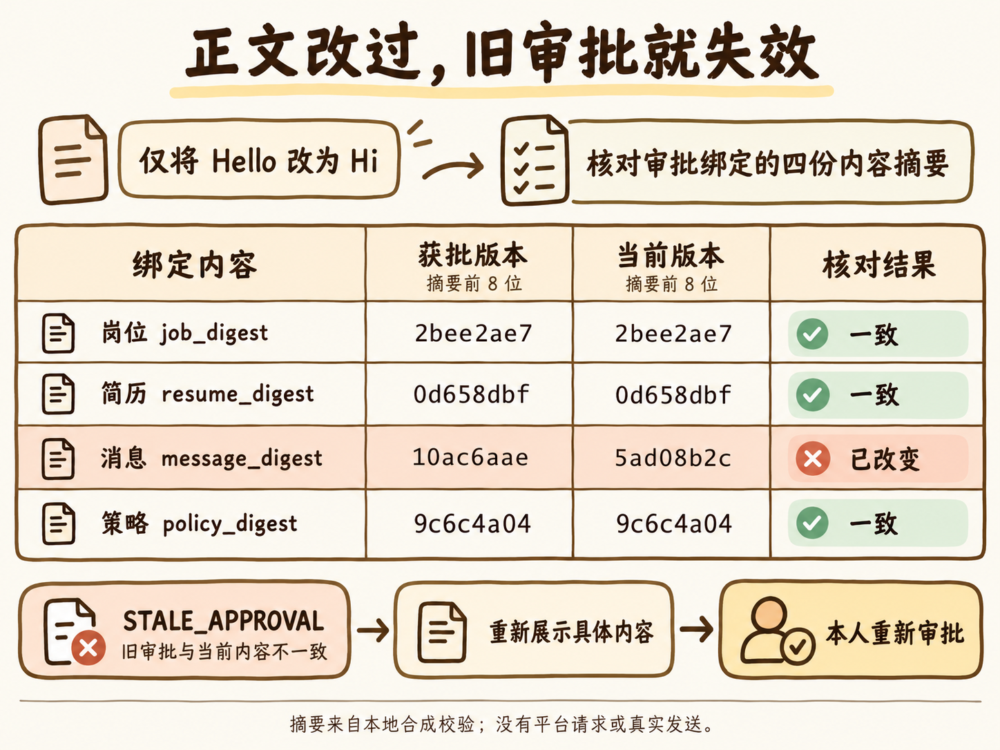

# CareerHarness

用于 Codex、Claude Code 和个人 AI 助手的求职工作流，包含候选人证据、岗位分析、定向简历和逐项发送审批。

[](docs/assets/career-harness-v4/workflow.png)

[工作链路](#工作链路)
[快速体验](#快速体验)
[选择使用方式](#选择使用方式)
[能力与边界](#能力与边界)
[使用指南](docs/usage.md)
[参与贡献](CONTRIBUTING.md)

从简历中提取的经历先由本人确认，再用于匹配岗位和起草材料。程序保留引用证据、文本差异和复核结果；消息与附件经本人逐项批准后，交给具备相应能力的宿主执行。

当前为 0.4.0 开发者 Alpha（见 [版本记录](CHANGELOG.md)），需要 Python 3.11+，按 [Apache-2.0](LICENSE) 开源。

适合愿意使用 AI 助手、配置 Python 环境并参与逐项确认的求职者，也适合复用求职能力的 Agent 开发者。核心程序提供契约、校验与记账；推理、浏览器、账号、定时和通知由实际宿主提供，并在你的环境中分别验收。

## 工作链路

首图概括从资料确认到投后复盘的链路：先处理已有对话，再补充新岗位；已确认的证据供匹配、消息和简历共用。完整的[文字底稿](docs/workflow-outline.md)与[实现范围](docs/workflow-implementation.md)单独保留。

### 满足交换条件，再准备定向简历

招聘方索取简历、本人决定继续推进，或明确要求直接申请，才进入对应材料链路。对方的请求触发准备；本人审批具体全文与附件后才执行发送。

[](docs/assets/career-harness-v5/resume-exchange.png)

### 发出之后，继续观察和改进

看招呼的触达与回复、简历后的约面转化，定位问题段；提出具体规则，经本人确认后供下一轮使用，再根据后续结果复核。

[](docs/assets/career-harness-v5/feedback.png)

*以上为工作流说明图。渠道统一接入编排仍有缺口；运营、诊断与规则复核已通过 [PR #9](https://github.com/Joshuazhang99662200/full-stack-ai-jobagent/pull/9) 合入 `main`，使用时需固定对应版本。已读不回率还需明确观察窗口、分母与排除规则，见[实现说明](docs/workflow-implementation.md)。*

## 简历改写的证据和差异

定向草稿引用已确认证据，diff 由基础简历与变体直接计算。独立复核单独校验主张；缺少复核时，即使草稿给自己标了“有依据”，也不能通过。

[](docs/assets/career-harness-v5/evidence.png)

*图中将程序处理合成夹具的输出重新绘制为说明图。复核结论由测试夹具提供，不代表真实模型独立复核。原始数据见[合成输出](docs/assets/career-harness-v2/samples.json)，配图来源与审核记录见[素材目录](docs/assets/career-harness-v5/README.md)。*

| 你关心的事 | 工作流如何处理 |
|---|---|
| 简历写得更贴合，也要真实 | 从已确认证据出发改写；保留每条主张的出处，缺少依据就报告缺口 |
| 岗位多，先看哪些 | 完整 JD、硬条件与证据分别评估；匹配结果带理由，待判断项保留给本人 |
| AI 写完之后谁来检查 | 草稿与独立复核分开；通过校验后再组装变体、计算 diff、排版并检查 PDF |
| 发出去的内容由谁决定 | 展示具体岗位、准确全文和实际附件；逐项批准，发送前重新核验 |
| 会话中断后如何接着做 | 保存运行状态、产物摘要、等待点和会话租约，支持 Codex / Claude Code 交接 |
| 我的选择会不会影响后续搜索 | 保留原始反馈、支持证据与反例，形成可追溯的软优先级；硬条件与候选人事实继续独立校验 |

## 审批绑定具体内容

预览、批准和发送各有独立入口。投递审批绑定岗位、简历、消息与策略的摘要；任何一项变化，都需要重新评审。简历附件还要核对实际成品与对应文件摘要。

[](docs/assets/career-harness-v5/approval.png)

*这里只执行本地合成校验，没有平台请求或真实发送授权。程序放行后，仍需宿主执行或人工交接，并核对结果。*

登录、验证码、风控、限流和不明确的发送结果会暂停相应操作，交由本人处理。定时任务、搜索反馈和模型生成结果都不授予发送权限。

## 快速体验

先用内置合成数据看看程序输出。下面的读取命令不需要个人简历、平台账号或模型 API 密钥，也不会发送招聘消息。

```bash
git clone https://github.com/Joshuazhang99662200/full-stack-ai-jobagent.git
cd full-stack-ai-jobagent
python -m pip install -e .

# 搜索内置合成岗位
jobagent jobs search python --source mock

# 查看一条带完整 JD 的合成岗位
jobagent jobs fetch alpha-001 --source mock

# 发现优化器能力与策略元数据
jobagent optimizer capabilities
```

你会得到结构化 JSON：搜索中包含 `Python Platform Engineer`，读取结果保留原始 JD 与来源信息；能力发现返回可检查的索引条目。**这些命令用于局部体验**，不会生成定向简历或替你完成一次申请。

开发者可继续运行已有的完整离线合成工作流测试，检查独立安装、证据确认、定向草稿与复核、PDF 校验、模拟审批、dry-run 和人工交接：

```bash
python -m pip install -e ".[dev]"
python -m pytest -q tests/workflows/test_harness_skill.py
```

测试中的审批答复和资料全部为合成数据，不构成真实发送授权。安装包独立性、摘要完整性与私有数据排除的检查见 [分发测试](tests/harness/test_distribution.py)。

## 选择使用方式

| 你的环境 | 从哪里开始 | 要准备什么 |
|---|---|---|
| Codex / Claude Code | [安装独立 Skill](docs/usage.md#从-github-安装-skill) | Git、Python 3.11+、自己的私有工作区；浏览器与调度按宿主能力验收 |
| Muse 等 Personal AI | [宿主入口与可复制启动文本](hosts/personal-ai/README.md) | GitHub 读取、私有文件、Python、网页与定时能力；逐项展示真实工具回执 |
| Python / CLI 开发者 | [使用指南](docs/usage.md) · [架构](docs/architecture.md) | 安装核心包，按类型化契约调用单项能力 |
| 已使用本地桥接的用户 | [MCP 与会话信箱](docs/usage.md#聊天前端桥接本地-mcp-与会话信箱) · [Cowork 交接](docs/cowork-handoff.md) | 本机运行环境与相应配置；这是可选路径 |

展示名为 **CareerHarness**；当前 GitHub 仓库和 Python 分发包仍使用 `full-stack-ai-jobagent`，命令仍为 `jobagent`，Skill 仍为 `job-hunting`。

## 能力与边界

以所使用版本的[能力目录](skills/job-hunting/references/capability-catalog.md)为状态权威。运营模块的入口与统计口径另见流程实现说明；程序实现、宿主能力与真实账号验收分别看待。

| 能力 | 当前状态 | 使用边界 |
|---|---|---|
| 候选人档案与证据 | 已实现 | PDF 页码溯源、草稿导入、缺口问答；本人可按编号列表或 Markdown 确认一组，程序仍逐个证据 ID 登记 |
| 职位发现与匹配 | 已实现 | 合成源、猎聘只读 listing、人工 JD 与宿主观察导入；定向分析需要完整 JD |
| 定向简历 | 已实现核心链路 | 草稿交接 → 独立复核 → 校验组装 → diff；可选本地渲染另需依赖与视觉检查 |
| 招呼、回复、对话与巡检 | 已实现门禁与记账 | 招呼生成、逐项审批、租约、回读与跟进；网页读取和实际消息发送由宿主执行 |
| 搜索反馈学习 | 已实现有边界的核心 | 支持与反例核验后调整软优先级；私有持久化和调度由宿主承担 |
| 运行恢复与 Skill 分发 | 已实现 | 同版本 runtime、SHA-256 清单、会话租约与产物检查；宿主工具需分别验收 |
| 平台简历投递 | 当前交人完成 | 猎聘连接器无法传递获批附件与消息，提交前停止；其他不支持的连接器同样交人 |
| Personal AI 集成 | 提供协议，按账号验收 | 可读取入口与核心不代表 Muse 的网页、定时、审批转交与发送回读已经接通 |
| 运营指标、诊断与规则效果复核 | 已实现（main） | 提供 metrics、diagnose、规则提案、本人确认与后续效果复核；入口和统计口径见流程实现说明 |
| 批量简历投递与无人值守全流程编排 | 尚未落地 | 批量投递只有契约；运营规则的确认不授予自动发送权限 |

项目当前定位为开发者 Alpha。真实平台的可用性取决于账号、平台状态与宿主能力；这里不承诺全平台开箱即用。

## 为开发者保留清楚的边界

`src/jobagent/schemas/` 是类型权威。领域服务与 CLI、SQLite、浏览器和平台 SDK 分离，搜索、生成、审批和执行各自独立。外部 JD、简历与消息作为数据处理，不能扩大权限。

```text
AI 助手 / job-hunting Skill / CLI / MCP
                   ↓
        候选人 · 职位 · 简历 · 审批 · 审计
                   ↓
             类型契约与服务边界
                   ↓
       私有存储 / 提供方 / 渲染器 / 连接器
```

新增能力要同步更新能力目录；测试会核对目录与实际 CLI 命令集合。提交前的四项门禁见[贡献指南](CONTRIBUTING.md#质量门禁)。

| 文档 | 内容 |
|---|---|
| [使用指南](docs/usage.md) | Skill 安装、候选人导入、JD、匹配、外联、巡检与本地桥接 |
| [能力目录](skills/job-hunting/references/capability-catalog.md) | 已实现、仅契约、未开始与外部委托的完整状态 |
| [架构](docs/architecture.md) · [领域模型](docs/domain-model.md) | 依赖方向、核心模型与不变式 |
| [Harness 协议](skills/job-hunting/references/harness.md) · [宿主对比](docs/harness-comparison.md) | 恢复、交接、产物检查和宿主分工 |
| [开源复用评审](docs/oss-review.md) | 上游来源、许可证与复用方式 |
| [岗位任务队列](docs/polling-console.md) | React 公共组件、岗位并行时间轴、宿主完整字段查询与九态历史 |

## 隐私与参与

个人资料、数据库与运行状态放在私有工作区，本地常用路径已加入 `.gitignore`。使用外部模型、云端 AI 宿主或可选飞书通知时，相关内容可能传给对应服务；删除本地文件不等于删除第三方副本。具体数据流与删除范围见[隐私说明](PRIVACY.md)。

欢迎用合成数据报告问题、改进文档与补齐独立测试。请先读[贡献指南](CONTRIBUTING.md)；编码智能体先读 [AGENTS.md](AGENTS.md)。安全问题按[安全策略](SECURITY.md)私密报告。

近期发布工作集中在合成演示、持续集成、安装体验和不同宿主的真实验收。新增平台能力始终保留证据确认与人工审批门禁。

按 [Apache-2.0](LICENSE) 开源。
