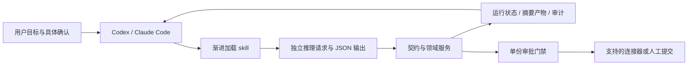

# 结构、Agent 与 Harness 差异清单

核查日期：2026-10-08。这里将“react 架构”按智能体 ReAct 理解；前端 React 属于界面层，不决定任务权限、恢复或事实校验。下表是产品定位与代码审阅的比较，未进行竞品账号实测，也不推断截图使用的具体模型版本。

## 本仓库的代码构造

| 层 | 当前入口 | 作用 |
|---|---|---|
| 类型权威 | `src/jobagent/schemas/` | 候选人、职位、主张、审批、推理与运行状态契约 |
| 原子领域能力 | `candidate/`、`jobs/`、`optimizer/`、`applications/` | 显式事实确认、匹配、改写与确定性校验、单份审批门禁 |
| 持久化与来源 | `storage/`、`connectors/` | SQLite、隔离运行文件、只读猎聘与公开 JD；平台交付能力明确区分 |
| 推理交接 | `reasoning/handoff.py`、`prompts.py` | 当前宿主产出类型化 JSON；请求独立目录、schema、来源策略、结构化恢复参数 |
| 渐进上下文 | `skills/job-hunting/` | L0 索引、入口路由、optimizer 嵌套路由与按需策略；不执行索引入口 |
| Harness | `harness/`、`cli/harness.py` | 会话租约、等待点、摘要产物、跨宿主交接、PDF 核对、真实审计结果 |
| 分发 | `scripts/build_skill.py`、skill 内 `scripts/bootstrap.py` | 两种宿主独立包、白名单、完整性清单、私有运行环境 |

改动前项目已经有候选人、职位、定向生成与审批代码；README 和入口技能的阶段描述落后于实现，容易让宿主误以为能力不存在。更关键的缺口是技能目录不能独立运行、handoff 同名覆盖且恢复参数不全、空主张台账通过、生成自评被当作复核、组装丢失策略来源摘要，以及猎聘只发送 job ID/kind 却报告定制附件交付。此次对这些缺口加入了可执行门禁与测试。

## 与主流架构的区别

ReAct 描述推理、行动和观察交替更新计划的方式，本身不规定持久状态、凭证隔离、内容审批或恢复协议。本项目复用 Codex/CC 的模型与工具循环，将确定性规则、状态和上下文组织作为可携带 Harness。两者可组合。[ReAct 原论文](https://arxiv.org/abs/2210.03629)

Agentspace 已并入 Gemini Enterprise。当前产品包含企业数据连接、搜索、跨应用工作流和集中治理，Agent Platform 文档还描述注册表、MCP/A2A 接入与观测能力。本仓库聚焦单用户求职工作区，没有企业索引、管理员治理平面或托管 agent fleet。[Google 更新说明](https://cloud.google.com/blog/products/ai-machine-learning/bringing-ai-agents-to-enterprises-with-google-agentspace/)、[Gemini Enterprise](https://cloud.google.com/gemini-enterprise)、[Agents overview](https://docs.cloud.google.com/gemini-enterprise-agent-platform/agents)

Muse 是个人智能体产品，运行于每用户独立的云 VM，带浏览器、连接器与长期工作环境；Muse Spark 是模型系列。已查到的 Spark 1.3 官方发布说明强调长任务、主动构建上下文、保留约束与用户协作，不能据此推断截图模型。[Muse 发布](https://about.fb.com/news/2026/09/introducing-muse-personal-ai-agent/)、[Spark 1.3](https://research.meta.ai/blog/introducing-muse-spark-1-3)

| 比较项 | 本次 Harness | ReAct | Agentspace / Gemini Enterprise | Muse 个人智能体 |
|---|---|---|---|---|
| 推理控制 | 宿主循环，类型化请求与独立复核 | reasoning / action / observation 方法 | 企业模型、工具和工作流平台 | 产品集成模型与执行环境 |
| Context | 确认证据、JD、相关母版、按需策略；确定性词项选择 | 依具体实现 | 企业数据连接与搜索 | 跨应用与长期个人工作上下文 |
| 长期状态 | 私有 SQLite、RUN 产物及等待点 | 方法本身未规定 | 托管平台服务 | 持续云工作环境 |
| 权限边界 | 四摘要绑定的逐份审批，宿主协助真人答复 | 方法本身未规定 | 集中数据/agent 权限管理 | Sentinel 管理外部动作权限 |
| 恢复与切换 | 同一工作区释放、获取租约；产物变更拒绝 | 依具体实现 | 平台治理与运行能力 | VM 中持续工作 |
| 浏览器登录 | 使用已提供宿主能力或人工网站登录 | 依工具 | 依集成 | 浏览器 broker 与独立凭证服务 |
| 后台调度 | 用户明确要求后借宿主；缺能力交接 | 依运行器 | 平台工作流 | VM 内后台工作 |
| 简历真实性 | 每项文本、证据、指标及独立复核门禁 | 通用方法不内建 | 通用产品不等同求职领域契约 | 截图不能证明每条简历事实接地 |

Muse 的安全设计将 runtime、凭证和 Sentinel 分离，授权直接在客户端进行；普通本地 skill 的同进程检查无法提供相同的防篡改权限隔离。发布时的 Secure VM 与计划中的 Confidential VM 也有区别，不能把“连 Meta 都无法访问”当作已全面落地。[Meta 安全设计](https://research.meta.ai/blog/security-and-safety-for-ai-agents-our-approach-with-muse)

## 截图体验的交付程度

| 截图能力 | 本次交付 | 剩余条件 |
|---|---|---|
| GitHub skill 加载后开始求职 | 完整发布包或从 checkout 构建，支持两宿主目录 | 尚未发布；不能只复制未构建源码子目录 |
| 自动找匹配岗位 | 现有发现、完整 JD、过滤与匹配契约；skill 负责推进 | 平台 CLI/账号、公开正文或人工补齐；LinkedIn 无本项目连接器 |
| 岗位确认后生成定向简历 | 草稿、独立复核、diff 与变体门禁 | 宿主实际推理与用户事实确认 |
| PDF | 外部渲染协议和严格文字/顺序/页数核对 | 安装渲染器、模板契合已验证内容并做版面检查 |
| 连续完成多项工作 | 可以持续只读发现与准备；每份交接独立 | 每一次发送仍需具体审批，不提供批量投递编排 |
| 定制附件投递与招聘方消息 | 门禁、dry-run、平台缺能力时准确停下 | 需支持附件和消息的连接器，当前人工提交 |
| 密码安全存储与自动恢复登录 | 宿主能力探测与安全交接协议 | 需要实际凭证服务；不会在聊天收集密码 |
| 每天 10 点、关闭 App 后运行 | 只读调度协议、等待/恢复与新结果通知规则 | 当前宿主原生调度与持续可访问工作区；没有自建云 VM |
| 长期个人记忆 | 确认后的职业事实、偏好、产物与审计 | 没有跨邮箱/日历持续观察、个人图谱或自动反思服务 |

本次“自启动”指 skill 被用户调用后初始化并推进获授权步骤。模型权重训练、后台守护进程、原生安全凭证卡片与云 VM 不在交付范围。结果以测试与实际能力为准；最终验收记录见设计文档。
