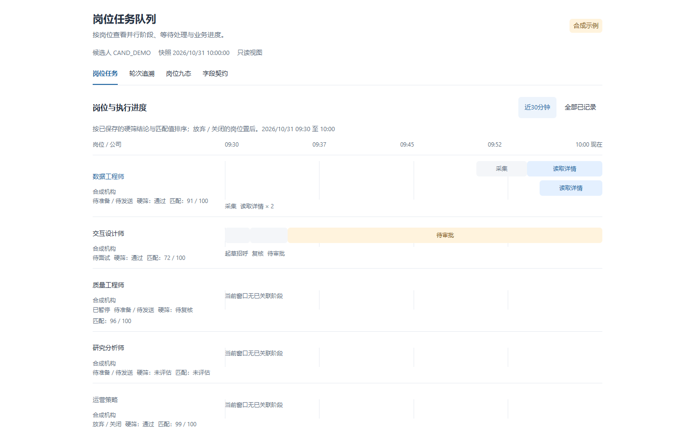
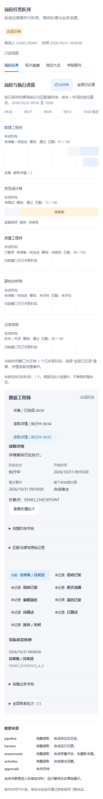

# 轮询控制台 Hallmark 审核

本页保留初版运行视图的审核记录；当前岗位主视图、排序和并行时间轴的最终审核见 [岗位队列审核](2026-10-31-job-queue-hallmark.md)。

审核日期：2026-10-31。范围为实际 React 应用界面，采用 modern-minimal、app scope；材料为由 Python 权威契约生成的合成快照，不含真实候选人或真实任务。

## 结论

Hallmark 最终静态及浏览器审核为 **0 FAIL、0 REFLEX、0 WARN**，未使用豁免。运行、岗位、来源缺失三个视图共生成 15 张截图，覆盖 375px 手机和 1280、1440、1920px 桌面。独立复核的三项问题均已修正并回归验证。

| 初次发现 | 修正 | 验证 |
|---|---|---|
| 手机时间轴短阶段文字截断、目标过窄 | 时间比例图保留，阶段使用独立完整名称和 44px 触控按钮 | 320px 阶段点选测试及手机截图 |
| 来源缺失却显示确认无记录 | 只有来源完整且集合为空才显示无记录，其他情况显示暂不可确认 | 缺失来源测试、实际本地空来源页面截图 |
| unknown 状态在详情与时间轴中仍可能显示执行中 | 所有非 current 的开放阶段统一显示未确认；已完成事实保留 | unknown、terminal 参数化测试及过期阶段截图 |
| 轮次、岗位选择控件偏高 | 选择按钮与静态时间信息分别排版，调整行内间距 | 最终 Hallmark 39b 无未处理项 |
| 页面混用四种字重 | 明确 strong 字重，统一为三种 | 最终 Hallmark F19 无警告 |

## 代码与数据检查

- 全套 Python：1811 passed，539.88 秒。
- Ruff 通过，mypy 的 243 个源文件通过，差异空白检查通过。
- React 独立页面、组件库及声明文件构建通过；无浏览器全局变量的 SSR 检查通过。
- 最终独立 Edge 运行：13 项浏览器测试通过，13.4 秒，覆盖 320–1920px、完整字段、真实历史、错误与加载状态。
- 公开示例包含三个岗位、四轮运行；ConsoleSnapshot 严格校验与活动生命周期校验通过；示例 JSON Schema 与当前 definitions 输出相等。
- 新增公共文件检查未发现私有数据库、私有目录、生成依赖目录或用户身份字符串。

## 交付与限制

页面当前由本人或宿主点击刷新读取本地快照。宿主也可以为嵌入组件自行管理快照更新；页面不会改变实际轮询任务调度或读取额度。

阶段记录需要宿主显式调用 console event；旧运行没有记录的内部阶段不会自动还原。部分旧外联审批记录缺少候选人归属，当前显示未接入。查看运行等待审批状态不代表已加载具体审批材料，也不授予发送或批准权限。

启动、完整字段查询、MCP 和阶段记录协议见 [使用说明](../polling-console.md)。截图均为合成示例：

